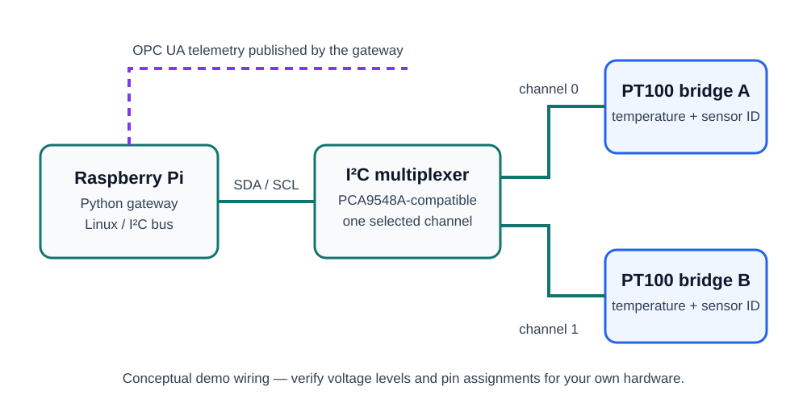

# Raspberry Pi PT100 OPC UA Gateway

This small, self-contained Python project demonstrates a Raspberry Pi gateway that publishes a PT100 temperature value and a sensor ID through OPC UA. It uses a simulator by default and contains no employer, customer, network, or device-specific information.



## Quick overview

```text
 PT100 element
      │
      ▼
 PT100 I²C bridge ──┐
                    │ channel 0 / 1
 PT100 I²C bridge ──┘
                    ▼
          I²C multiplexer
                    │ SDA / SCL
                    ▼
             Raspberry Pi
       Python PT100 gateway
                    │
                    ▼
              OPC UA server
                    │
                    └── Pt100Sensors/<sensor>
                         ├── TemperatureCelsius
                         ├── SensorId
                         ├── LastUpdate
                         └── Status
```

| File | Responsibility |
| --- | --- |
| `pt100_opcua_gateway.py` | Creates the OPC UA server and updates the sensor variables. |
| `pt100_backend.py` | Defines sensor configuration plus real-I²C and simulated PT100 backends. |
| `i2c_multiplexer.py` | Selects an I²C multiplexer channel using a small hardware abstraction. |

## What it demonstrates

- asynchronous Python with `asyncio`
- a typed configuration for multiple PT100 channels
- an OPC UA address space with `TemperatureCelsius`, `SensorId`, `LastUpdate` and `Status`
- a generic Raspberry Pi I2C multiplexer abstraction with channel selection
- a hardware adapter interface and a runnable simulated PT100 backend
- structured logging and focused automated tests

## Design choices

The OPC UA gateway, the PT100 measurement backend and the I2C multiplexer are deliberately separated. The default `SimulatedPt100Backend` makes the sample runnable on every computer. `I2cPt100BridgeBackend` shows where a real Raspberry Pi I2C bridge belongs: it selects the configured multiplexer channel, reads a temperature and reads the sensor ID. The public example protocol is deliberately generic and configurable; a real device adapter must follow its own public data sheet.

`I2cMultiplexer` models the standard one-hot channel selection interface of a PCA9548A-compatible board. The wiring diagram is intentionally conceptual: it demonstrates a common Raspberry Pi setup, not a production schematic or a customer system.

For clarity, the example deliberately leaves out production topics such as certificates, user management, persistent storage, metrics, retries, and deployment configuration. In a production environment, I would add these based on the security and operational requirements of the target system.

## Run locally

```bash
python -m venv .venv
.venv\\Scripts\\activate
python -m pip install -r requirements.txt
python pt100_opcua_gateway.py
```

The demo server listens on `opc.tcp://localhost:4840/pt100-gateway/`. It publishes two simulated sensors from `config.example.json`; both expose a stable demo sensor ID and a changing temperature value.

## Run the test

```bash
python -m unittest -v
```

## Scope

This is an independently created portfolio sample. It is intentionally generic and does not reproduce any employer code, hardware addressing, network configuration, wiring plan, or proprietary device protocol.
